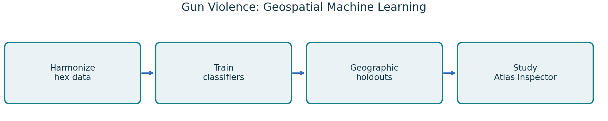
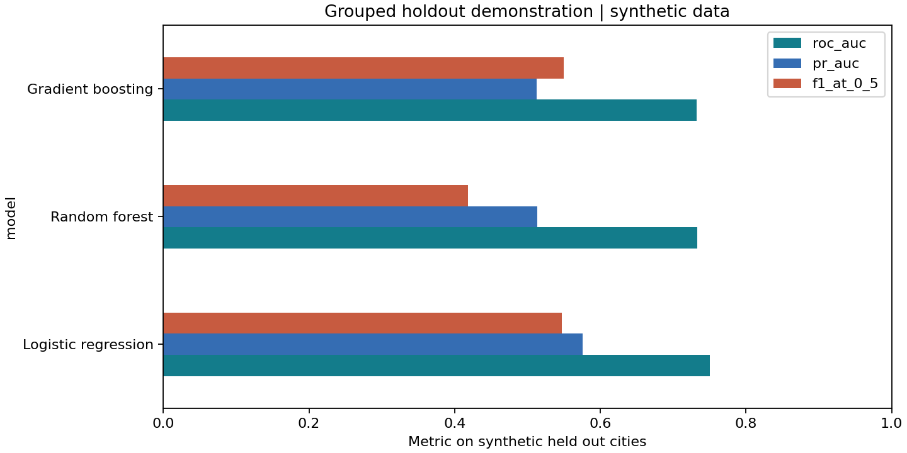

# Gun Violence Prediction: Geospatial Machine Learning

**Python · Five classical classifiers · Geographic evaluation · SHAP · FastAPI / SQLite**

A multi-city ASU Quark Lab study of structural spatial risk patterns across **35 U.S. metropolitan areas and 11,448 hexagonal cells**. The repository contains the research notebooks, five-model comparison workflow, and the source of **Study Atlas**, a local map-based model inspection application. A separate synthetic demonstration makes the evaluation workflow runnable without redistributing enriched research data.



## Quick start

Use Python 3.11 from the repository root:

```bash
python -m venv .venv
# Windows: .venv\Scripts\activate
# macOS/Linux: source .venv/bin/activate
python -m pip install -r requirements.txt
python scripts/demo.py
python -m unittest discover -s tests -v
```

The public demo creates 1,050 fictional hexagons across 35 synthetic groups and 22 predictors. It holds out entire groups, fits imputation and scaling only on training rows, and compares logistic regression, Random Forest and Gradient Boosting at a fixed 0.5 threshold. It writes machine-readable metrics under `outputs/demo/` and regenerates this image:



The demo's three models keep installation lightweight. Historical research additionally uses XGBoost and LightGBM. Demo values are synthetic software evidence; they must never be substituted for the study's recorded metrics.

## What the research does

The historical workflow harmonizes city data into a common hexagonal structure, prepares predictors, examines multicollinearity and imbalance, and compares logistic regression, Random Forest, Gradient Boosting, XGBoost and LightGBM. Evaluation includes ROC AUC, precision, recall, F1 and cross-validation. SHAP supports inspection of fitted model contributions.

The target is **whether Total_Gun_Violence is greater than zero** for the supplied observations. It is not a prediction of a named person's behavior, a causal estimate or an independently validated future incident probability. Observation dates cannot be inferred merely from folder names.

Keep the study's dimensions separate: the paper discusses 52 predictors, the raw table has 59 columns, the main model uses 22 features, and a separate city-holdout experiment uses 21. The 53-city Twitter extension is a different experiment and is not silently pooled into these results.

## Recorded evaluation

| Experiment | Model | ROC AUC | F1 | Qualification |
|---|---|---:|---:|---|
| Main random-hex split | LightGBM | 0.8743 | 0.5248 | F1 at 0.50; historical selection/preprocessing limits |
| Separate city holdout | Random Forest | 0.9051 | 0.6325 | Different experiment and feature configuration |
| Separate regional holdout | Random Forest | 0.8542 | 0.3989 | Geographic transfer can degrade markedly |

These figures are source-recorded research results, not a fresh full-study reproduction. Random hex splits can share city context across train and test. Earlier full-data preprocessing and test-set threshold/model selection limit independent validation; later geographic experiments improve train-only preprocessing. No single metric demonstrates prospective forecasting, fairness, calibration or causal intervention benefit.

## Study Atlas application

`digital_twin/` holds the original FastAPI backend, browser frontend, feature validation, saved-model integration, SQLite scenario storage, fingerprints and SHAP inspection. Users can inspect baseline inputs, change scenario values and compare outputs. Scenario changes are **model sensitivity**, not recommendations to alter demographic characteristics or proof that an intervention will change outcomes.

The source application needs its research artifacts and approved data before it can run. These are deliberately absent from the public clone. [Setup instructions](docs/REPRODUCIBILITY.md) explain reconstruction. Keep it bound to localhost: this is a single-user research application, not an authenticated production service. Existing geometry may be estimated points unless authoritative matching GeoJSON is supplied. Render/Docker configuration alone is not evidence of a live cloud deployment.

## Repository contents

| Path | Contents |
|---|---|
| `research/Gun_Violence_ML_Pipeline.executed.ipynb` | Core notebook; historical name retained, public outputs cleared |
| `research/Gun_Violence_KFold_CV.ipynb` | Five-fold comparison notebook |
| `research/run_kfold.py` | Five-model cross-validation and split comparison |
| `digital_twin/app/` | API, input validation, scoring and persistence |
| `digital_twin/frontend/` | Map and scenario interface |
| `digital_twin/scripts/` | Artifact and fidelity builders |
| `scripts/demo.py` | New synthetic grouped holdout example |
| `tests/` | Geographic isolation, preprocessing and bounded-score checks |
| `docs/` | Data, model limitations, reproduction and attribution |

## Research reference

Satpathy, Asish; Subramanian, Vinay Vikkranth; Tiwari, Avantika. **A Harmonized Multi-City Architecture for Structural Spatial Risk Modeling**, AMCIS 2026, paper 1353. [Official AIS proceedings record](https://aisel.aisnet.org/amcis2026/sig_dsa/sig_dsa/9/).

The proceedings record confirms publication and coauthorship. The repository does not redistribute the publisher PDF or imply that every application component appeared in the paper. [NOTICE](NOTICE.md) explains reuse and collaborative attribution.
